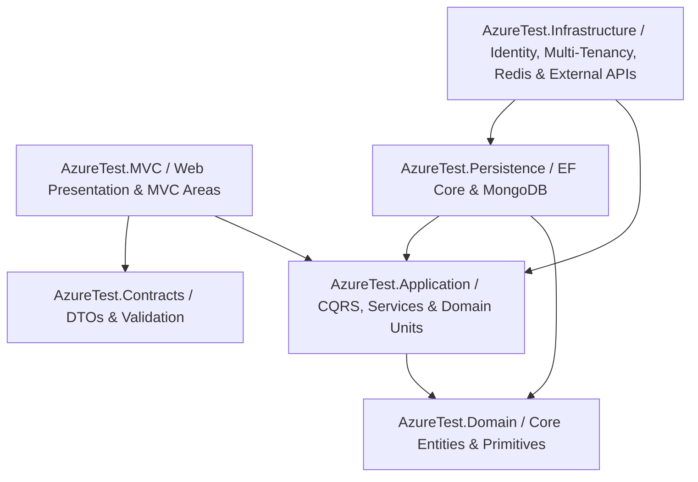
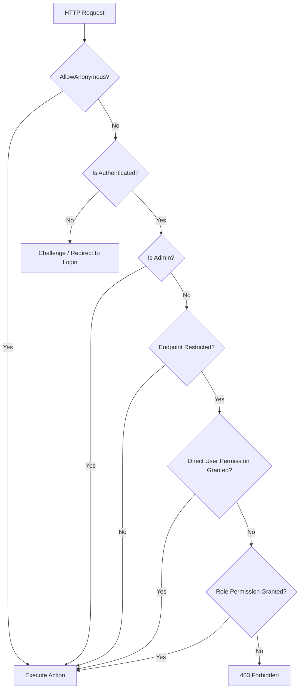

# TrackerPro (AzureTest)

TrackerPro is an enterprise-grade, multi-tenant productivity, daily life, fitness, financial, career, media, and algorithmic trading management platform built on **.NET 10**, **C# 13**, and **ASP.NET Core MVC**. Designed around **Clean Architecture**, **CQRS**, and **Polyglot Persistence**, TrackerPro provides a comprehensive suite of personal and enterprise modules with a responsive mobile-first UI, Progressive Web App (PWA) support, real-time paper trading, institutional Forex & Crypto intelligence, granular direct user security, and live SignalR updates.

---

## Architecture & Core Design Principles



### 1. Clean Architecture Layers
- **Domain (`AzureTest.Domain`)**: Pure enterprise entities, value objects, domain primitives (`Entity`, `BaseEntity`, `ValueObject`, `ITenantEntity`, `ISoftDelete`), and business invariants with zero external dependencies. Includes dedicated domain aggregates for Trading, Forex, Crypto, Media, Identity, and Habits.
- **Contracts (`AzureTest.Contracts`)**: Data transfer objects (DTOs), requests, responses, pagination filters (`PagedResult<T>`), and FluentValidation rules shared across application boundaries.
- **Application (`AzureTest.Application`)**: CQRS orchestration using specialized `ICommandHandler` and `IQueryHandler` interfaces, domain units (`ITradingCommandUnit`, `IForexUnits`, `ICryptoUnits`, `IUserPermissionCommandUnit`), validation pipelines, and business workflows.
- **Persistence (`AzureTest.Persistence`)**: Polyglot storage combining **Entity Framework Core** (SQL Server / LocalDB) for relational transactions and **MongoDB** for high-volume NoSQL document stores (`DocumentRepository`, `NoSqlUnitOfWork`, `WatchItemDocument`).
- **Infrastructure (`AzureTest.Infrastructure`)**: ASP.NET Core Identity, JWT and Cookie authentication, Google OAuth2 SSO, Multi-Tenancy management (`ITenantProvider`), Distributed Caching via Redis (`IRedisService`), TMDb API client, Hangfire job scheduling, OpenTelemetry tracing, Serilog logging, and HealthChecks.
- **Web Presentation (`AzureTest.MVC`)**: ASP.NET Core MVC application organized into modular Areas (`Trading`, `Forex`, `Crypto`, `FootballFantasy`), styled with Tailwind CSS, FontAwesome 6, TomSelect, Chart.js, and SignalR hubs.
- **Unit Testing (`AzureTest.UnitTest`)**: Comprehensive xUnit test suite testing query handlers, command validators, domain logic, paper trading math, risk calculations, and multi-tenancy filters.

### 2. Multi-Tenancy & Admin Tenant Impersonation
- **Tenant Isolation**: Entities implementing `ITenantEntity` are automatically filtered via EF Core Global Query Filters and MongoDB `DocumentRepository` base filters.
- **Live Impersonation**: Platform administrators can impersonate any tenant workspace on-demand from the UI.
- **Visual Impersonation Indicator**: Floating mobile/tablet burger button and top status banners pulsate with an amber alert indicator while impersonating.
- **Read-Only Safeguards**: Configurable `AllowImpersonationWrites` feature option to protect tenant data from unintentional modifications during support sessions.

### 3. Feature Management & Toggle System
Configurable feature flags via `InfrastructureFeatureOptions` in `appsettings.json`:
- `MobileFloatingNavigation`: Toggles the mobile floating bottom and top controls (default: `true`).
- `TabletFloatingNavigation`: Toggles tablet-optimized floating navigation (default: `true`).
- `EnableDirectUserPermissions`: Toggles user-level direct permission overrides and bypassing of role restrictions (default: `true`).
- `EnableMultiTenancy`: Activates tenant partitioning and workspace management.
- `AllowImpersonationWrites`: Enables/restricts mutation requests during admin tenant impersonation.
- `EnableGoogleAuth`: Activates Google OAuth2 authentication and account linking.
- `EnableHangfire`: Toggles background job processing dashboard and workers.
- `EnableOpenTelemetry`, `EnableSerilog`, `EnableHealthCheck`, `EnableHealthCheckUI`.

---

## Security & Granular Access Control

TrackerPro provides a hybrid authorization model combining Role-Based Access Control (RBAC) with User-Level Direct Permissions and Dynamic Authorization filtering:



### 1. User Direct Permissions (`UserDirectPermission`)
- **Granular Override Architecture**: Allows administrators to grant or revoke specific permissions (controller/action/area) directly to an individual user, overriding or augmenting their role permissions.
- **Instant Bypassing**: When a permission is explicitly granted to a user, the user bypasses role requirements for that endpoint.
- **User Permission Management UI (`/UserPermission/Index?userId=...`)**: Per-user matrix showing assigned roles, effective permissions, and interactive toggles to grant or revoke specific access rights with category filtering and instant search.
- **Redis Caching**: Cached in Redis under `UserPermissions_{userId}` for zero-latency authorization checks.
- **`ICurrentUser` Integration**: The `CurrentUser.Permissions` collection automatically consolidates both role-derived permissions and explicit direct user grants.

### 2. Role Permissions Management
- **Role Permissions Matrix (`/Permission/RolePermissions`)**: Full-featured matrix interface for assigning controller and area permissions to Identity roles.
- **Multi-Attribute Filtering & Grouping**: Filter by Area (`Trading`, `Forex`, `Crypto`, Root), Controller, and Action; group by Area or Controller; and sort dynamically.
- **Dynamic Authorization Filter (`DynamicAuthorizationFilter`)**: Intercepts every MVC request, resolves route endpoints with area prioritization, and evaluates cached permission sets.

### 3. Google OAuth2 & Smart Account Linking
- **Single Sign-On (SSO)**: One-click sign-in and registration using Google OAuth2 credentials.
- **Smart Account Linking**: Existing users with verified email addresses can authenticate via Google without redundant account creation.
- **Account Disconnect & Re-link**: Manage linked external logins directly from the user profile.

---

## Module Overview

### 1. Universal Paper Trading Terminal (`/Trading`)
Designed for simulated multi-asset market execution with zero capital risk:
- **Universal Multi-Asset Terminal**: Execute simulated paper trades across Cryptocurrencies (`BTCUSDT`, `ETHUSDT`, `SOLUSDT`), Forex currency pairs (`EURUSD`, `GBPUSD`, `USDJPY`), Stocks, Indices, and Futures.
- **Real-Time Market Data Stream**: Live quotes, 24h change percentages, high/low metrics, and bid/ask spreads powered by `TradingMarketDataService` with automated refresh and fallback resilience.
- **Real-Time Trade Closure Detection**: Automatic detection and client-side notifications when active positions hit Stop Loss (SL) or Take Profit (TP) without requiring a full page reload.
- **Interactive Order Ticket**: Place Market, Limit, and Stop orders with configurable quantity, leverage, Stop Loss, and Take Profit.
- **Live Protective Order Editing**: Modify Stop Loss and Take Profit levels on active positions on-the-fly.
- **Position Management**: One-click position closing at current market price, partial scale-outs, and pending order cancellation.
- **Interactive Watchlist**: Search catalog assets, filter by asset class, and pin favorite instruments.
- **Balance Reset**: Customize or reset starting demo capital ($50,000 default) at any time.
- **Batch JSON Execution Engine**: Submit programmatic trade instruction batches via JSON for automated trading script simulations.

### 2. Institutional Forex Trading Hub (`/Forex`)
Comprehensive environment for currency traders based on institutional market mechanics:
- **Forex Market & Session Matrix**:
  - Live bid/ask rates, real-time spreads, pip change counters, and precious metals/indices.
  - Interactive multi-timeframe candlestick charts with volume profiles.
  - Global Market Sessions tracker (Sydney, Tokyo, London, New York) with visual session overlaps, countdowns, and volatility heatmaps.
  - Broker spread comparison table across major retail and ECN brokers.
- **Forex Trading Terminal**:
  - Live order tickets with market, limit, and stop orders with idempotency protection.
  - Trade controls: modify Stop Loss and Take Profit, Trailing Stops, partial lot closure, and one-click Move to Break-Even.
  - Real-time margin monitor, leverage checks, and Emergency Kill Switch (instant liquidation of all positions and pending order cancellation).
  - External signal receiver via TradingView Webhook (`ProcessTradingViewWebhook`).
  - Demo balance reset utility.
- **Technical Analysis & Institutional SMC**:
  - Technical indicator suite: Moving Averages (EMA 9/21/50/200, SMA 20/50), RSI 14, MACD, Average True Range (ATR), Bollinger Bands, and classical/Fibonacci pivot levels.
  - Smart Money Concepts (SMC): Break of Structure (BOS), Change of Character (CHoCH), Order Blocks (+OB/-OB), Fair Value Gaps (FVG), Liquidity Sweeps, and Premium/Discount Optimal Trade Entry (OTE) zones.
  - Currency Strength Meter across 8 major currencies (USD, EUR, GBP, JPY, AUD, CAD, CHF, NZD) and currency pair correlation matrix.
- **Fundamental & Macro Context**:
  - High-impact economic calendar with filterable impact levels and countdown timers.
  - Central bank interest rate differentials and monetary policy outlooks.
  - Commitment of Traders (COT) non-commercial net positioning reports.
- **Quantitative Strategy & Monte Carlo Backtesting**:
  - Strategy catalog including London Breakout, Trend Pullback, and Range Mean Reversion.
  - Simulation engine incorporating spread modeling, execution slippage, and overnight swap fees.
  - 10,000-path Monte Carlo probability distribution simulating equity drawdowns, risk of ruin, and win-rate variance.
  - Walk-Forward Analysis (WFA) cross-validation to guard against curve-fitting and parameter overfitting.
- **Risk Management & Regulatory Compliance**:
  - Interactive lot size calculator factoring in equity, risk percentage, and pip stop distances.
  - News no-trade filter enforcing blackout periods around tier-1 economic releases.
  - ESMA and AFM leverage limit compliance monitors and exposure distribution charts.
- **Psychological Trading Journal & Tax Export**:
  - Trade execution reflections logging setup criteria, mindset ratings, emotional state tags (Disciplined, FOMO, Revenge, Greed), and trade screenshots.
  - Exportable RFC 4180 CSV tax reports detailing realized gains/losses across all closed trades.
- **API Settings & Simulator Latency**:
  - Manage API integrations for Twelve Data, Alpha Vantage, FRED, and Finnhub with simulator latency configuration and legal risk disclosures.

### 3. Cryptocurrency Intelligence & Derivatives Hub (`/Crypto`)
Institutional-grade crypto analytics, derivatives intelligence, and automated execution:
- **Market Data & Order Flow**:
  - Real-time ticker feeds, 24h gainers/losers, volume rankings, and Fear & Greed sentiment index.
  - Order book depth ladder (bids/asks), spread metrics, and recent tape executions.
  - Order Flow Hub: Cumulative Volume Delta (CVD), Footprint chart clusters, order book liquidity heatmap walls, Coinbase Premium Index, and stablecoin depeg monitoring radar.
- **Derivatives & Futures Analytics**:
  - Perpetual funding rate heatmap across major exchanges (Binance, Bybit, OKX).
  - Open Interest (OI) aggregation and Long/Short positioning ratios.
  - Liquidation map and real-time liquidation feed.
  - Options analytics: Deribit options Implied Volatility (IV), 25-Delta Skew, and Max Pain strike pricing.
  - Futures basis curve comparing spot prices against quarterly futures contracts.
- **On-Chain Intelligence & Token Flow**:
  - Centralized Exchange (CEX) net flows tracking whale deposits, exchange reserves, and miner flows.
  - Large whale wallet transfer tracking and on-chain accumulation alerts.
  - Token Unlocks Calendar: Vesting schedules, cliff vs. linear release tracking, and dilution pressure shock scores.
  - DEX Screening & Rugpull Detector: Automated smart contract audits, honeypot detection, liquidity pool (LP) lock verification, and capital efficiency analysis.
- **Advanced Technical Analysis & Market Regimes**:
  - Technical indicators: EMA ribbons, RSI, MACD, Bollinger Bands, ATR volatility, and Pivot Points.
  - Institutional SMC: Order Blocks (+OB/-OB), Fair Value Gaps (FVG), Liquidity Sweeps, and OTE discount zones.
  - Visible Range Volume Profile (VPVR): Point of Control (POC), Value Area High (VAH), Value Area Low (VAL), and High/Low Volume Nodes (HVN/LVN).
  - Multi-Anchor VWAP with ±1σ and ±2σ standard deviation volatility bands.
  - Quantitative Market Regime Detection: ADX trend strength, ATR% volatility, Bollinger Bandwidth squeeze detection, Hurst Exponent mean-reversion analysis, and algorithmic strategy allocation suggestions.
  - Curated CryptoPanic news feed and social sentiment monitoring.
- **Execution & Smart Trading Algorithms**:
  - Trade terminal supporting Market, Limit, and Stop orders with leverage, Stop Loss, and Take Profit.
  - Algorithmic Order Types: Time-Weighted Average Price (TWAP), Iceberg hidden reserve orders, and Trailing Stop protection.
  - 3-Dimensional Arbitrage Scanner: Cross-Exchange Spreads, 3-Leg Triangular Cycles, and Delta-Neutral Funding Rate Arbitrage with simulated fee deductions and slippage controls.
- **Risk Preservation & Liquidation Guard**:
  - Margin dashboard displaying maintenance margin, leverage limits, and daily drawdown caps.
  - Dynamic ATR position sizing calculator.
  - Liquidation Guard: Margin top-up calculator and position risk trimming to push back liquidation thresholds.
  - Emergency Kill Switch to immediately market-close all positions and cancel active orders.
- **Portfolio Analytics & Dutch Box 3 Tax Reporting**:
  - Net Asset Value (NAV) tracker, unrealized/realized P&L, asset allocation breakdowns, and performance analytics.
  - Crypto Trading Journal with psychological discipline tagging.
  - Dutch Box 3 Asset Valuation report pegged to the official January 1 reference date.
  - MiCA-compliant trade transaction ledger with one-click export to RFC 4180 CSV.
  - Paper trading capital reset ($10,000 USDT clean slate).
- **Multi-Channel Alerts**:
  - Automated alert dispatcher for price targets, RSI/MACD triggers, and algorithmic trade signals delivered across Telegram, Email, Webhooks, and In-App notifications.
- **Security & API Encryption**:
  - Exchange API credential storage secured with AES-GCM-256 encryption.
  - Enforces strict read/trade-only API policies with zero withdrawal permissions permitted.

### 4. Entertainment & Media (Powered by TMDb)
- **Watchlist & Progress**: Track Movies, TV Series, and Anime across statuses (Plan to Watch, Watching, Completed, On Hold, Dropped).
- **Season & Episode Tracking**: Interactive episode checklists pulling official metadata, air dates, and overviews from The Movie Database (TMDb).
- **Scoped Rewatch Metrics**:
  - Independent repeat watch counters for individual Episodes, entire Seasons, or complete Titles.
  - Repeat watch counters (`2x`, `3x` badges on posters and detail pages).
  - Total rewatch hours, repeat count, and **Most Rewatched Favorites** leaderboard.
  - Scoped Undo Rewatch capability to revert accidental repeat logs without affecting watch history.
- **TMDb Integration**:
  - Real-time search across movies, series, and anime with progress badges.
  - Discover feed with trending titles, top-rated selections, and genre filters.
  - Cast & Talent details (filmographies, biography with expandable read-more, directing credits).
  - Release Calendar for upcoming theatrical and streaming premieres.
  - Movie News feed with curated industry headlines.
  - Custom Playlists (e.g. *Weekend Marathon*, *Sci-Fi Classics*) with AJAX quick-add modals.

### 5. General & Productivity
- **Customizable Dashboard**: Real-time KPI summaries, dynamic widgets, Chart.js data visualizations, and quick shortcuts.
- **Idea Tracker**: Multi-level idea planning with structured sections, pages, rich text notes, and categorization.
- **House Crawler**: Web scraper integration for residential real estate listings and search results.
- **Support Tickets**: Help desk ticket system with priority levels, status workflows, and live notifications.
- **Sample Notes**: Developer playground and markdown notes scratchpad.

### 6. Daily Life & Habit Management
- **Calendar**: Interactive monthly, weekly, and daily views for scheduled commitments.
- **DateTime Converter**: Timezone conversions, Unix epoch timestamps, duration calculators, and ISO formatting.
- **Task Management**: Prioritized to-do tracking with due dates, tags, and completion statuses.
- **Event Scheduling**: Agenda planner for one-off and recurring personal/work events.
- **Habit Tracking**: Habit consistency streaks, completion history, and milestone badges.
- **Pomodoro Timer**: Configurable focus intervals, short/long breaks, session statistics, and audio cues.

### 7. Career & Application Center
- **Resume Builder**: Profile summaries, experience logs, ATS score calculators, and export tools.
- **Job Crawler**: Automated scraper extracting job listings, requirements, and company details.
- **Company Directory**: Target employer records, interview stages, and recruiter contacts.
- **Resume Files**: Document repository for PDF resumes, cover letters, and application attachments.

### 8. Gym & Fitness Hub
- **Workout Tracker**: Log daily routines, exercise sets, reps, load weights, and rest intervals.
- **Weight & Body Analytics**: Log weight entries, track BMI, calculate body fat metrics, and analyze long-term trends with interactive charts.
- **Gym Courses**: Course catalog, instructor schedules, and enrollment management.
- **Gym Trainings (Exercise Master)**: Comprehensive exercise catalog with media guides, target muscle groups, and equipment tags.

### 9. Food & Nutrition System
- **Daily Food Diary**: Caloric intake tracking, macro-nutrient distributions (carbs, protein, fats), and meal logs (Breakfast, Lunch, Dinner, Snacks).
- **Recipe Book**: Step-by-step cooking recipes, prep times, serving counts, and nutritional breakdown.
- **Chef Workspace**: Culinary development tool for creating and standardizing new dishes.
- **Athlete Hub**: High-protein macro calculators and performance meal suggestions.
- **Weekly Meal Planner**: Drag-and-drop calendar for planning meals across the week.
- **Pantry & Stock Management**: Inventory tracking for pantry items, expiry date warnings, and stock movement logs.
- **Smart Shopping List**: Automated ingredient aggregation from meal plans with one-click purchase completion.
- **Ingredient Master**: Nutritional database of raw ingredients and caloric densities.

### 10. Financials & Budgeting
- **Expense Tracking**: Multi-currency expenditure tracking with dates, payment methods, receipts, notes, and OCR receipt scanner.
- **Expense Categories**: Multi-tenant aware category hierarchy with search and grouping.
- **Debt Management**: Track money owed to you and money you owe with repayment progress bars.
- **Debt Analytics**: Visual breakdown of open debts, counterpart risk, and upcoming settlement deadlines.
- **Debt Contacts Directory**: Master contact registry for persons involved in loans and debts.

### 11. System, Administration & Security
- **User Management**: User creation, profile management, lockout control, and credential administration.
- **User Direct Permissions**: Individual user permission overrides and category-based management matrix (`/UserPermission/Index`).
- **Role-Based Access Control (RBAC)**: Fine-grained permission assignments per controller and action with filtering, sorting, and grouping (`/Permission/RolePermissions`).
- **Identity Settings**: Password complexity, lockout policies, and session expiration configurations stored in MongoDB.
- **Transactional Email Service**: Gmail SMTP integration via `IEmailSenderService` for account activation and password resets.
- **File Explorer**: Web-based file system browser for application assets.
- **UI Components & Icon Gallery**: Interactive catalog of custom UI components, modals, and searchable FontAwesome icons.
- **Audit Trail**: Immutable system audit log recording every user and background operation with timestamps and IP addresses.
- **SignalR Real-Time Hub**: Live ticket notifications with audio alerts and active online user counter.
- **Interactive Version Bumper**: Integrated semantic version control (`scripts/bump_version.py`) displayed in the sidebar.

### 12. Knowledge Base & Dynamic Pages
- **Documentation Engine**: Custom HTML/Markdown documentation pages.
- **User Read Tracking**: Automatically tracks which users have read each page and displays "New" labels in navigation for unread documents.
- **Engagement Counters**: Like and reaction tracking for internal documents.

### 13. Fantasy Football Area
- **Fantasy Leagues**: Community and private fantasy league standings.
- **Predict Clubs**: Match outcome predictions, scoring rules, and leaderboards.
- **Achievements & Venues**: Gamification badges, stadium records, and venue metadata.

---

## Mobile & Tablet User Experience

TrackerPro features a responsive mobile and tablet interface that transforms into an app-like experience:

1. **Floating Bottom Navigation**:
   - Displays a glassmorphic floating bar at the bottom with 8 icons: General, Daily, Application, Gym, Food & Cooking, Financials, Entertainment & Media, and System.
   - Tapping an icon slides down the main bar and slides up the section's sub-navigation with specific feature icons and a **Back** button.
   - **Scroll-Aware Animation**: Automatically glides down out of view when scrolling down, and glides back up when scrolling up.
2. **Top Floating Controls**:
   - **Floating OmniBar**: Command palette search box (Cmd+K) floating at the top of the screen; automatically slides up to hide on scroll-down and slides down on scroll-up. Features touch-friendly inline close controls for mobile virtual keyboards.
   - **Floating 3-Dot & Burger Navigation**: Top-left burger button opens the off-canvas navigation drawer; top-right 3-dot menu provides quick access to profile, preferences, and theme toggling. Turns amber (`bg-amber-500 animate-pulse`) when admin tenant impersonation is active.
   - **Floating Notification Bell**: Displays live unread count badges and opens the SignalR notification dropdown.
3. **Progressive Web App (PWA)**:
   - Web App Manifest (`manifest.json`) and service worker support.
   - Interactive installation guide modal for iOS (Safari) and Android (Chrome) to install TrackerPro directly onto the phone's home screen.

---

## Tech Stack

| Layer | Technologies |
|---|---|
| **Framework** | .NET 10.0 / C# 13 |
| **Web Presentation** | ASP.NET Core MVC (Areas: Trading, Forex, Crypto, FootballFantasy), Razor Pages |
| **Styling & UI** | Tailwind CSS, FontAwesome 6, Chart.js, TomSelect |
| **Persistence (Relational)** | Entity Framework Core 10, SQL Server / LocalDB |
| **Persistence (NoSQL)** | MongoDB Driver, Mongo BsonClassMap |
| **Distributed Caching** | StackExchange.Redis / Redis Cache Service |
| **Real-Time Communications** | Microsoft SignalR |
| **Authentication & SSO** | ASP.NET Core Identity, Google OAuth2, Dynamic Authorization Filter |
| **Security & Cryptography** | AES-GCM-256 (API Credential Encryption), BouncyCastle |
| **Background Jobs** | Hangfire |
| **Validation** | FluentValidation |
| **Observability** | OpenTelemetry, Serilog, Seq, HealthChecks UI |
| **External Integrations** | TMDb API, Binance API, Frankfurter API, Twelve Data, Alpha Vantage, FRED, Finnhub, Gmail SMTP |
| **Testing** | xUnit, Moq, FluentAssertions |

---

## Getting Started

### Prerequisites
- [.NET 10.0 SDK](https://dotnet.microsoft.com/download)
- [SQL Server](https://www.microsoft.com/sql-server) or SQL Server LocalDB
- [Redis](https://redis.io/) (Local or Docker container)
- [MongoDB](https://www.mongodb.com/) (Optional: in-memory / mock fallback runs if MongoDB is not present)
- [TMDb API Key](https://www.themoviedb.org/documentation/api) (Optional: for live movie/series metadata)
- [Google Client ID & Secret](https://console.cloud.google.com/) (Optional: for Google OAuth2 SSO)

### Installation & Run

1. **Clone the repository**:
   ```bash
   git clone <repository-url>
   cd AzureTest
   ```

2. **Configure Connection Strings & Feature Options**:
   Review and adjust settings in `src/AzureTest.MVC/appsettings.Development.json`:
   ```json
   {
     "ConnectionStrings": {
       "DefaultConnection": "Server=(localdb)\\mssqllocaldb;Database=AzureTestDb;Trusted_Connection=True;MultipleActiveResultSets=true",
       "Redis": "localhost:6379"
     },
     "MongoDb": {
       "ConnectionString": "mongodb://localhost:27017",
       "DatabaseName": "AzureTestNoSqlDb"
     },
     "Authentication": {
       "Google": {
         "ClientId": "YOUR_GOOGLE_CLIENT_ID",
         "ClientSecret": "YOUR_GOOGLE_CLIENT_SECRET"
       }
     },
     "EmailSettings": {
       "SmtpServer": "smtp.gmail.com",
       "Port": 587,
       "SenderEmail": "your-email@gmail.com",
       "SenderName": "TrackerPro Security",
       "Password": "YOUR_APP_PASSWORD"
     },
     "InfrastructureFeatures": {
       "MobileFloatingNavigation": true,
       "TabletFloatingNavigation": true,
       "EnableDirectUserPermissions": true,
       "EnableGoogleAuth": true,
       "EnableMultiTenancy": false,
       "AllowImpersonationWrites": false,
       "EnableHangfire": true
     }
   }
   ```

3. **Apply Database Migrations**:
   ```bash
   dotnet ef database update --project src/AzureTest.Persistence --startup-project src/AzureTest.MVC
   ```

4. **Build and Run**:
   ```bash
   dotnet build
   dotnet run --project src/AzureTest.MVC
   ```

5. **Access the Application**:
   - Open your browser to `https://localhost:7154` (or your configured port).
   - Sign in with seeded admin credentials or authenticate with Google.
   - Universal Paper Trading: `/Trading`
   - Institutional Forex Hub: `/Forex/ForexMarket`
   - Crypto Intelligence Hub: `/Crypto/CryptoMarket`
   - User Permissions Management: `/UserPermission`
   - Role Permissions Matrix: `/Permission/RolePermissions`
   - Hangfire Dashboard: `/hangfire`
   - Health Checks UI: `/healthchecks-ui`

### Running Tests
Execute the unit test suite:
```bash
dotnet test test/AzureTest.UnitTest/AzureTest.UnitTest.csproj
```

---

## License

This project is licensed under the MIT License.
