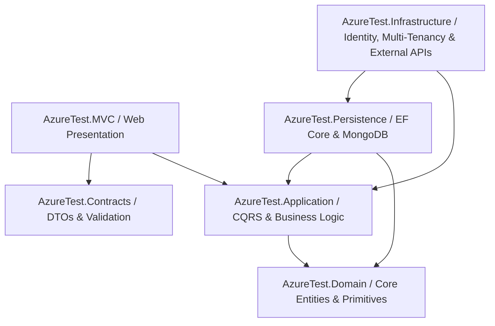

# TrackerPro (AzureTest)

TrackerPro is an enterprise-grade, multi-tenant productivity, daily life, fitness, financial, career, and media management platform built on **.NET 10**, **C# 13**, and **ASP.NET Core MVC**. Designed around **Clean Architecture**, **CQRS**, and **Polyglot Persistence**, TrackerPro provides a comprehensive suite of personal and business management modules with a responsive mobile-first UI, Progressive Web App (PWA) support, and live SignalR updates.

---

## Architecture & Core Design Principles



### 1. Clean Architecture Layers
- **Domain (`AzureTest.Domain`)**: Pure enterprise entities, value objects, domain primitives (`Entity`, `ValueObject`, `ITenantEntity`, `ISoftDelete`), and business invariants with zero external dependencies.
- **Contracts (`AzureTest.Contracts`)**: Transfer objects (DTOs), requests, responses, pagination filters, and FluentValidation rules shared across application boundaries.
- **Application (`AzureTest.Application`)**: CQRS orchestration using specialized `ICommandHandler` and `IQueryHandler` interfaces, validation pipelines, unit interfaces, and business workflows.
- **Persistence (`AzureTest.Persistence`)**: Polyglot storage combining **Entity Framework Core** (SQL Server / LocalDB) for relational transactions and **MongoDB** for high-volume NoSQL document stores (`DocumentRepository`, `NoSqlUnitOfWork`).
- **Infrastructure (`AzureTest.Infrastructure`)**: ASP.NET Core Identity, JWT and Cookie authentication, Multi-Tenancy management (`ITenantProvider`), TMDb API client, Hangfire job scheduling, OpenTelemetry tracing, Serilog logging, and HealthChecks.
- **Web Presentation (`AzureTest.MVC`)**: ASP.NET Core MVC application styled with Tailwind CSS, FontAwesome 6, TomSelect, Chart.js, and SignalR hubs.
- **Unit Testing (`AzureTest.UnitTest`)**: Comprehensive xUnit test suite testing query handlers, command validators, domain logic, and multi-tenancy filters.

### 2. Multi-Tenancy & Admin Tenant Impersonation
- **Tenant Isolation**: Entities implementing `ITenantEntity` are automatically filtered via EF Core Global Query Filters and MongoDB `DocumentRepository` base filters.
- **Live Impersonation**: Platform administrators can impersonate any tenant workspace on-demand from the UI.
- **Visual Impersonation Indicator**: Floating mobile/tablet burger button and top status banners pulsate with an amber alert indicator while impersonating.
- **Read-Only Safeguards**: Configurable `AllowImpersonationWrites` feature option to protect tenant data from unintentional modifications during support sessions.

### 3. Feature Management & Toggle System
Configurable feature flags via `InfrastructureFeatureOptions` in `appsettings.json`:
- `MobileFloatingNavigation`: Toggles the mobile floating bottom and top controls (default: `true`).
- `TabletFloatingNavigation`: Toggles tablet-optimized floating navigation (default: `true`).
- `EnableMultiTenancy`: Activates tenant partitioning and workspace management.
- `AllowImpersonationWrites`: Enables/restricts mutation requests during admin tenant impersonation.
- `EnableHangfire`: Toggles background job processing dashboard and workers.
- `EnableOpenTelemetry`, `EnableSerilog`, `EnableHealthCheck`, `EnableHealthCheckUI`.

---

## Module Overview

### 1. General & Productivity
- **Customizable Dashboard**: Real-time KPI summaries, dynamic widgets, Chart.js data visualizations, and quick shortcuts.
- **Idea Tracker**: Multi-level idea planning with structured sections, pages, rich text notes, and categorization.
- **House Crawler**: Web scraper integration for residential real estate listings and search results.
- **Support Tickets**: Help desk ticket system with priority levels, status workflows, and live notifications.
- **Sample Notes**: Developer playground and markdown notes scratchpad.

### 2. Daily Life & Habit Management
- **Calendar**: Interactive monthly, weekly, and daily views for scheduled commitments.
- **DateTime Converter**: Timezone conversions, Unix epoch timestamps, duration calculators, and ISO formatting.
- **Task Management**: Prioritized to-do tracking with due dates, tags, and completion statuses.
- **Event Scheduling**: Agenda planner for one-off and recurring personal/work events.
- **Habit Tracking**: Habit consistency streaks, completion history, and milestone badges.
- **Pomodoro Timer**: Configurable focus intervals, short/long breaks, session statistics, and audio cues.

### 3. Career & Application Center
- **Resume Builder**: Profile summaries, experience logs, ATS score calculators, and export tools.
- **Job Crawler**: Automated scraper extracting job listings, requirements, and company details.
- **Company Directory**: Target employer records, interview stages, and recruiter contacts.
- **Resume Files**: Document repository for PDF resumes, cover letters, and application attachments.

### 4. Gym & Fitness Hub
- **Workout Tracker**: Log daily routines, exercise sets, reps, load weights, and rest intervals.
- **Weight & Body Analytics**: Log weight entries, track BMI, calculate body fat metrics, and analyze long-term trends with interactive charts.
- **Gym Courses**: Course catalog, instructor schedules, and enrollment management.
- **Gym Trainings (Exercise Master)**: Comprehensive exercise catalog with media guides, target muscle groups, and equipment tags.

### 5. Food & Nutrition System
- **Daily Food Diary**: Caloric intake tracking, macro-nutrient distributions (carbs, protein, fats), and meal logs (Breakfast, Lunch, Dinner, Snacks).
- **Recipe Book**: Step-by-step cooking recipes, prep times, serving counts, and nutritional breakdown.
- **Chef Workspace**: Culinary development tool for creating and standardizing new dishes.
- **Athlete Hub**: High-protein macro calculators and performance meal suggestions.
- **Weekly Meal Planner**: Drag-and-drop calendar for planning meals across the week.
- **Pantry & Stock Management**: Inventory tracking for pantry items, expiry date warnings, and stock movement logs.
- **Smart Shopping List**: Automated ingredient aggregation from meal plans with one-click purchase completion.
- **Ingredient Master**: Nutritional database of raw ingredients and caloric densities.

### 6. Financials & Budgeting
- **Expense Tracking**: Multi-currency expenditure tracking with dates, payment methods, receipts, and notes.
- **Expense Categories**: Multi-tenant aware category hierarchy with search and grouping.
- **Debt Management**: Track money owed to you and money you owe with repayment progress bars.
- **Debt Analytics**: Visual breakdown of open debts, counterpart risk, and upcoming settlement deadlines.
- **Debt Contacts Directory**: Master contact registry for persons involved in loans and debts.

### 7. Entertainment & Media (Powered by TMDb)
- **Watchlist & Progress**: Track Movies, TV Series, and Anime across statuses (Plan to Watch, Watching, Completed, On Hold, Dropped).
- **Season & Episode Tracking**: Interactive episode checklists pulling official metadata, air dates, and overviews from The Movie Database (TMDb).
- **Rewatch Metrics**:
  - Repeat watch counter (`2x`, `3x` badges on posters and detail pages).
  - Total rewatch hours, repeat count, and **Most Rewatched Favorites** leaderboard.
  - Rewatch button allowing completed titles to be logged again without losing watch history.
- **TMDb Integration**:
  - Real-time search across movies, series, and anime with progress badges.
  - Discover feed with trending titles, top-rated selections, and genre filters.
  - Cast & Talent details (filmographies, biography with expandable read-more, directing credits).
  - Release Calendar for upcoming theatrical and streaming premieres.
  - Movie News feed with curated industry headlines.
  - Custom Playlists (e.g. *Weekend Marathon*, *Sci-Fi Classics*) with AJAX quick-add modals.

### 8. System, Administration & Security
- **User Management**: User creation, profile management, lockout control, and credential administration.
- **Role-Based Access Control (RBAC)**: Fine-grained permission assignments per controller and action.
- **Dynamic Authorization Filter**: Automatically enforces permissions dynamically based on the requested route.
- **Identity Settings**: Password complexity, lockout policies, and session expiration configurations.
- **File Explorer**: Web-based file system browser for application assets.
- **UI Components & Icon Gallery**: Interactive catalog of custom UI components, modals, and searchable FontAwesome icons.
- **Audit Trail**: Immutable system audit log recording every user and background operation with timestamps and IP addresses.
- **SignalR Real-Time Hub**: Live ticket notifications with audio alerts and active online user count counter.

### 9. Knowledge Base & Dynamic Pages
- **Documentation Engine**: Custom HTML/Markdown documentation pages.
- **User Read Tracking**: Automatically tracks which users have read each page and displays "New" labels in navigation for unread documents.
- **Engagement Counters**: Like and reaction tracking for internal documents.

### 10. Fantasy Football Area
- **Fantasy Leagues**: Community and private fantasy league standings.
- **Predict Clubs**: Match outcome predictions, scoring rules, and leaderboards.
- **Achievements & Venues**: Gamification badges, stadium records, and venue metadata.

---

## Mobile & Tablet User Experience

TrackerPro features a responsive mobile and tablet interface that transforms into an app-like experience:

1. **Floating Bottom Navigation**:
   - Displays a glassmorphic floating bar at the bottom with 8 icons: General, Daily, Application, Gym, Food & Cooking, Financials, Entertainment & Media, and System.
   - Tapping an icon slides down the main bar and slides up the section's sub-navigation with specific feature icons and a **Back** button.
   - **Scroll-Aware Animation**: Automatically glides down out of view when scrolling down, and glides back up when scrolling up.
2. **Top Floating Controls**:
   - **Floating OmniBar**: Command palette search box (Cmd+K) floating at the top of the screen; automatically slides up to hide on scroll-down and slides down on scroll-up.
   - **Floating Sandwich/Burger Button**: Sticks to the top right; opens the off-canvas navigation drawer. Turns amber (`bg-amber-500 animate-pulse`) when admin tenant impersonation is active.
   - **Floating Notification Bell**: Displays live unread count badges and opens the SignalR notification dropdown.
3. **Progressive Web App (PWA)**:
   - Web App Manifest (`manifest.json`) and service worker support.
   - Interactive installation guide modal for iOS (Safari) and Android (Chrome) to install TrackerPro directly onto the phone's home screen.

---

## Tech Stack

| Layer | Technologies |
|---|---|
| **Framework** | .NET 10.0 / C# 13 |
| **Web Presentation** | ASP.NET Core MVC, Razor Pages |
| **Styling & UI** | Tailwind CSS, FontAwesome 6, Chart.js, TomSelect |
| **Persistence (Relational)** | Entity Framework Core 10, SQL Server / LocalDB |
| **Persistence (NoSQL)** | MongoDB Driver, Mongo BsonClassMap |
| **Real-Time** | Microsoft SignalR |
| **Background Jobs** | Hangfire |
| **Validation** | FluentValidation |
| **Observability** | OpenTelemetry, Serilog, Seq, Azure Monitor |
| **Testing** | xUnit, Moq, FluentAssertions |

---

## Getting Started

### Prerequisites
- [.NET 10.0 SDK](https://dotnet.microsoft.com/download)
- [SQL Server](https://www.microsoft.com/sql-server) or SQL Server LocalDB
- [MongoDB](https://www.mongodb.com/) (Optional: in-memory / mock fallback runs if MongoDB is not present)
- [TMDb API Key](https://www.themoviedb.org/documentation/api) (Optional: for live movie/series metadata)

### Installation & Run

1. **Clone the repository**:
   ```bash
   git clone <repository-url>
   cd AzureTest
   ```

2. **Configure Connection Strings & Feature Options**:
   Review and adjust settings in `src/AzureTest.MVC/appsettings.Development.json`:
   ```json
   {
     "ConnectionStrings": {
       "DefaultConnection": "Server=(localdb)\\mssqllocaldb;Database=AzureTestDb;Trusted_Connection=True;MultipleActiveResultSets=true"
     },
     "MongoDb": {
       "ConnectionString": "mongodb://localhost:27017",
       "DatabaseName": "AzureTestNoSqlDb"
     },
     "Tmdb": {
       "ApiKey": "YOUR_TMDB_API_KEY",
       "BaseUrl": "https://api.themoviedb.org/3"
     },
     "InfrastructureFeatures": {
       "MobileFloatingNavigation": true,
       "TabletFloatingNavigation": true,
       "EnableMultiTenancy": false,
       "AllowImpersonationWrites": false,
       "EnableHangfire": true
     }
   }
   ```

3. **Apply Database Migrations**:
   ```bash
   dotnet ef database update --project src/AzureTest.Persistence --startup-project src/AzureTest.MVC
   ```

4. **Build and Run**:
   ```bash
   dotnet build
   dotnet run --project src/AzureTest.MVC
   ```

5. **Access the Application**:
   - Open your browser to `https://localhost:7154` (or your configured port).
   - Sign in with seeded admin credentials or register a new workspace account.
   - Hangfire Dashboard: `/hangfire`
   - Health Checks UI: `/healthchecks-ui`

### Running Tests
Execute the unit test suite:
```bash
dotnet test test/AzureTest.UnitTest/AzureTest.UnitTest.csproj
```

---

## License

This project is licensed under the MIT License.
